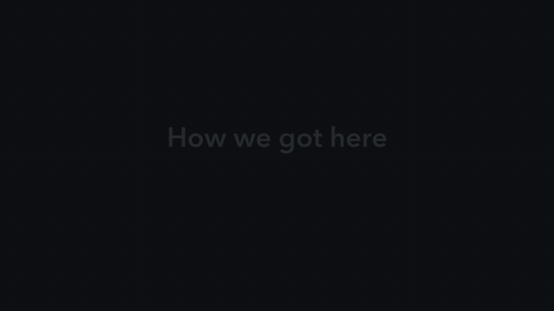

# Scan2Work

[](https://github.com/SinceAI-2026/scan2work/actions/workflows/checks.yml)

Scan2Work turns a Gaussian-splat scan of an industrial room (`Equipment Room.ply`) and the Valmet synthetic builder
workbook into an inspection twin. Equipment is extracted and framed in 3D, bound to the workbook's device data, and a
robot walks a collision-checked route to the faulty device, where a grounded AI diagnosis and a LOTO-first job
checklist open. Built for the Valmet × Since AI 2026 challenge.

The workbook supplies a synthetic fault scenario. The demo does not establish that the filmed equipment is faulty.

[Open the browser demo](https://scan2work.app/) · [Download release 0.1.1](https://assets.scan2work.app/releases/0.1.1/index.html)

## Quick start

**Prepared release** (Python 3.12, macOS or Linux, WebGL 2 browser; no GPU, API key or model download):

```sh
curl -fsSLo install-scan2work.sh https://assets.scan2work.app/releases/0.1.1/install.sh
bash install-scan2work.sh --install-dir ~/scan2work-0.1.1 --with-extraction --launch
```

The room opens at `http://127.0.0.1:8766/`, the optional 1,933-region extraction review at `:8768`. Restart with
`python3.12 ~/scan2work-0.1.1/start.py --open`, check with `--doctor`. Details:
[installation](docs/installation.md), [hosted preview](docs/public-demo.md).

**Latest source with prepared data** (Python 3.12; install the prepared release above first):

```sh
git clone https://github.com/SinceAI-2026/scan2work.git
cd scan2work
python3.12 -m venv .venv
.venv/bin/python -m pip install --only-binary=:all: -r requirements-demo.lock.txt
mkdir "$HOME/scan2work-source-data"
cp -R "$HOME/scan2work-0.1.1/data/baseline" "$HOME/scan2work-source-data/baseline"
VALMET_OFFLINE=1 VALMET_DATA_DIR="$HOME/scan2work-source-data/baseline" .venv/bin/python server.py 8765
```

Open `http://127.0.0.1:8765/`. Use a new data directory for this checkout: scene changes, saved objects and
inspection notes can be written there. Copy the complete dataset, including native source and membership files.
A code clone alone does not contain the generated room. These commands reuse prepared data and do not run the
extraction pipeline or paid model services. The immutable release contains its original code; the checkout adds
newer features without replacing that installation.

The viewer starts in **Simplified** mode: choose equipment, follow its route, then inspect the evidence and checklist.

On the first visit, **Show tutorial** introduces the controls with step-by-step highlights. Skip it or replay it from **Settings → Show tutorial**. **Show welcome on next visit** controls the next welcome prompt; the choice stays in this browser. Add `?tutorial=0` to suppress the automatic welcome for presentations. Library clone and take-apart links also bypass it. The tutorial pauses movement without editing service records or room objects. **Inspection tour** is the separate route, hazards and evidence sequence.
**Start inspection** names the selected destination; **Inspection tour** runs the separate guided walkthrough.
Open **Settings → Extended** for extraction, editing, BIM/AR and detailed data. Your information preference is saved
in this browser; changing it preserves the selection, route and service records. [View guide](docs/features.md#simplified-and-extended-information).

**Hazards** toggles potential-energy annotations. Pause, Stop or manual room interaction interrupts the guided demo;
watching it never completes jobs, changes Arduino readings or certifies safe work.

Hosted voice, shared synthetic jobs and Arduino access depend on the deployment configuration. When shared jobs
are enabled, visitors can see each other’s progress. Local prepared-data operation keeps external model calls off;
voice and hardware integrations are optional. See [hosted operation](docs/public-demo.md) and
[voice/MCP setup](docs/voice-mcp.md).

## Hosting

The deployment examples support a Python CPU server behind Cloudflare Workers, with R2 for versioned assets.
Browser rendering needs no server GPU; Workers alone do not run the Python backend. Configure your own accounts,
credentials and backups before deployment. See [CPU hosting](distribution/cpu-host/README.md),
[Google Cloud](distribution/gcp/README.md), and [Cloudflare](distribution/cloudflare/README.md).

## What it does

| Feature | In short | More |
|---|---|---|
| Extraction | 504 framed objects in 24 classes in the release room; labels from real walkthrough photos, checked against a hand-labelled sample | [Pipeline](docs/pipeline.md) |
| Two segmenters | Colour/geometry rules + Gemini labels (default), or SAM 2.1 + SigLIP 2/DINOv2 fully on-site | [Pipeline](docs/pipeline.md#two-segmenters) |
| Workbook binding | All 30 Excel devices on distinct objects; status, telemetry and citations come from the workbook only | [Technical notes](docs/technical-notes.md) |
| Navigation | A* with original clearances, finer routing through narrow passages and a compact technician; follow, first-person and aerial views | [Technical notes](docs/technical-notes.md#navigation-and-collision-model) |
| Information levels | Simplified technician workspace by default; Settings restores the complete Extended toolset | [View guide](docs/features.md#simplified-and-extended-information) |
| Inspection tour and hazards | Rasmus’s walking service technician, interruptible walkthrough and optional energy illustrations | [Integration and reuse](docs/rasmus-integration.md) |
| Device metrics | Canonical condition and next check, plus **Metrics & trends** for Excel readings, gauges and signal history in both information modes | [Metrics guide](docs/features.md#equipment-metrics-and-trends) |
| Manual object label | Find the washing machine, inspect its original scan region and test browser-local removal/restoration | [Manual washer](docs/features.md#manually-identified-washing-machine) |
| Asset library and copies | **Clone and place** previews a saved object; Place saves a browser-local copy, Cancel discards it. Copies have no borrowed device readings | [Library guide](docs/features.md#clone-and-place-a-library-object) |
| Tutorial and project | Optional first-visit tutorial, Settings replay, and **Project & team** background page | [Project & team](web/about.html) |
| Room layers | Scan / Coloured by class / BIM masks of the same view, explode, Show in room filters, floor plan and IFC export | [Features](docs/features.md#room-controls) |
| AI diagnosis | Grounded triage and LOTO-first verification steps; tested blind on the 13 faulty devices | [Technical notes](docs/technical-notes.md#diagnostics-and-optional-ai) |
| Technician jobs | **To inspect** queue, checklist with safety-first rules, notes, **Mark done** | [Features](docs/features.md#voice-assistant-elevenlabs-agent-ilkka) |
| Voice assistant | Ilkka (ElevenLabs) shows equipment, diagnoses and works the job over MCP; enabled on the main hosted demo, opt-in elsewhere | [Voice and MCP](docs/voice-mcp.md) |
| Take apart and AI 3D | Isolate and save objects (`.ply`, 3DGS, `.glb`); five pump units explode in the room; reviewed replacements from 18 imported AI-generated models | [Features](docs/features.md#take-a-pump-apart-in-the-room) |
| Arduino fault panel | A UNO Q shows the first open fault until its job is fixed; a hold with nothing left starts a simulated emergency. Tiger Data and Snowflake are used only here | [arduino/README.md](arduino/README.md) |
| AR overlay | The twin drawn over the real walkthrough video | `python -m scripts.render_overlay` |
| Other datasets | Modular importer and original-data preservation, `VALMET_DATA_DIR` | [Asset import](docs/asset-import-guide.md) |

## How the pipeline got here

[](docs/media/pipeline-approaches.mp4)

*Sped up 3×. [Full video, 2 min](docs/media/pipeline-approaches.mp4).* 2D-first detection (253 objects, 53 duplicate
pairs) was replaced by 3D-first segmentation (415 objects, 17 duplicate pairs); the experiments that were kept or
dropped are in [docs/pipeline.md](docs/pipeline.md#how-we-got-here).

## Evaluation

Measured on 7 November 2026 on the generated twin; each number comes from a command in this repo. The workbook data is
synthetic.

| Area | Measure | Result | Command |
|---|---|---|---|
| Brief | Requirement checks | all pass, 0 hard failures | `tests.scorecard` |
| Extraction | Label accuracy, 39 hand-labelled objects | 85 % (colour-rule baseline 13 %) | `tests.scorecard` |
| Extraction | 2D→3D lifting: fused centre inside the true box | 95 % | `tests.validate_lifting` |
| Mapping | Workbook devices on distinct objects | 30/30, 0 telemetry mismatches | `tests.scorecard` |
| Original robot route | Path samples off walkable floor / minimum clearance | 0 / 0.234 source units (radius 0.15) | `tests.scorecard` |
| AI diagnosis | Blind root cause, telemetry only (top-1 / top-3) | 9/13 / 11/13 (baseline 2/13) | `tests.eval_triage` |
| Grounding | Cited evidence IDs found in the workbook | all | `tests.scorecard` |
| Refinement | Colour error / SSIM vs a held-out photo, 6 objects | 0.162 → 0.123 / 0.340 → 0.399 | `tests.eval_refine` |
| Voice | Full CV-003 job by voice | 5/5 simulated runs | ElevenLabs tests |

The robot-route result describes the archived route; current passage and technician checks are recorded in the
[integration verification](docs/rasmus-integration.md#verification). Physical scale remains unverified.

Limits: navigation checks are kinematic and grid-based; with alarms included the diagnosis is near trivial (alarm
texts name the issue), so the telemetry-only row is the honest one; voice runs are text simulations.

## Repository

| Path | What |
|---|---|
| `pipeline/` | The extraction → binding → navigation → diagnostics pipeline (`python -m pipeline.run`) |
| `local_models/` | Optional on-site segmenter (SAM 2.1, SigLIP 2, DINOv2, OWLv2) and its committed results |
| `server.py`, `web/` | REST API and the Three.js viewer (no build step) |
| `mcp_server.py` | MCP tools for the voice assistant |
| `live/`, `arduino/` | Arduino fault panel: server side (Tiger Data, Snowflake) and the UNO Q app |
| `distribution/`, `scripts/` | Release packaging and helper scripts |
| `tests/` | Scorecard, evaluations and unit tests |

## Verify

```sh
.venv/bin/python -m unittest discover -s tests       # unit tests (the object-library test needs PyTorch)
.venv/bin/python -m tests.scorecard                  # every requirement of the brief, with numbers
node tests/test_navigation_view.mjs && node tests/test_journey.mjs && node tests/test_render_quality.mjs
```

## Rebuild the scene data

The complete generated dataset is not in git. Rebuilding is an optional developer workflow, not a setup step.
It requires the challenge inputs and additional dependencies from `requirements.txt`. It can overwrite generated
data and call paid AI services. Cached answers avoid calls only when the required cache entries are present; a
fresh clone does not guarantee a complete cache. Use the prepared-data quick start to explore the app.

1. Put the challenge files next to the repo (paths in `pipeline/config.py`): `../Equipment Room.ply`, and in
   `../Valmet_SinceAI2026 _1_/` the walkthrough video and the builder workbook.
2. Extract the walkthrough frames (their COLMAP poses are in `web/data/walk_poses.json`):

   ```sh
   mkdir -p web/data/walk_frames
   ffmpeg -i "../Valmet_SinceAI2026 _1_/Industrial Boiler Room (1).mp4" -vf "fps=3,scale=1280:-2" -q:v 3 web/data/walk_frames/f_%04d.jpg
   ```

3. Build and score: `bash scripts/check.sh` (expect 0 hard failures). Optional keys go in the git-ignored
   `secrets.env`: `OPENAI_API_KEY`, `GEMINI_API_KEY`, `HF_TOKEN`. `VALMET_SEGMENTER=local` builds on the local
   segmenter's objects instead.

A rebuild replaces generated viewer data and can call configured AI services; check generated metadata before claiming
a model ran ([generated artifact status](docs/technical-notes.md#generated-artifact-status)).

## Docs

- [Contributing](CONTRIBUTING.md) · [Security reporting](SECURITY.md)

- [Technical note (brief)](docs/technical-note.md) · [Pipeline](docs/pipeline.md) · [Features in detail](docs/features.md) · [Technical notes (full)](docs/technical-notes.md)
- [Installation](docs/installation.md) · [Dependencies](docs/dependencies.md) · [Hosted preview](docs/public-demo.md) · [R2 publishing](docs/cloudflare-r2.md)
- [Voice and MCP](docs/voice-mcp.md) · [Arduino fault panel](arduino/README.md) · [Local segmenter](local_models/README.md)
- [Rasmus integration and reusable modules](docs/rasmus-integration.md)
- [Asset import](docs/asset-import-guide.md) · [Original-data audit](docs/original-data-audit.md)
- Releases: [0.1.1](docs/release-0.1.1.md), [0.1.0](docs/release-0.1.0.md), [packaging audit](docs/packaging-audit.md)
- Submission: [slides (PDF, 8 slides)](docs/slides/scan2work-slides.pdf) · [demo recording script](docs/demo-sequence.md)

## Team and attribution

Five people, one shared challenge. Meet the team that came together to explore what industrial spatial intelligence could become.

- [Perttu Isotalo](https://www.linkedin.com/in/isotalo/)
- [Rasmus Mäkinen](https://www.linkedin.com/in/rasmusmakinen/)
- [Wael Al-Abbasi](https://www.linkedin.com/in/wael-al-abbasi-398b2126a/)
- [Linards Liepenieks](https://www.linkedin.com/in/linards-liepenieks/)
- [Mikael Lehtonen](https://www.linkedin.com/in/mikael-lehtonen-07a130361/)

Built at [Since AI 2026](https://sinceai.ai/hackathon), 6–8 November in Turku, Finland, for Valmet Automation’s
challenge. This public repository preserves the development history of the team’s original
[SinceAI-2026/Wael repository](https://github.com/SinceAI-2026/Wael), which may require access. Component provenance,
including scan2service and Rasmus’s contributions, remains documented in the feature and integration guides.

## License and attribution

This repository currently grants **no project-wide open-source license**. Public visibility does not grant a
blanket license to reuse or redistribute the project. Obtain permission from the relevant rights holders where
required. Existing third-party license notices remain applicable to their respective components; see
[dependencies](docs/dependencies.md). Challenge scans, workbook data, media and generated assets have separate
provenance and permissions and are not relicensed by this publication.
