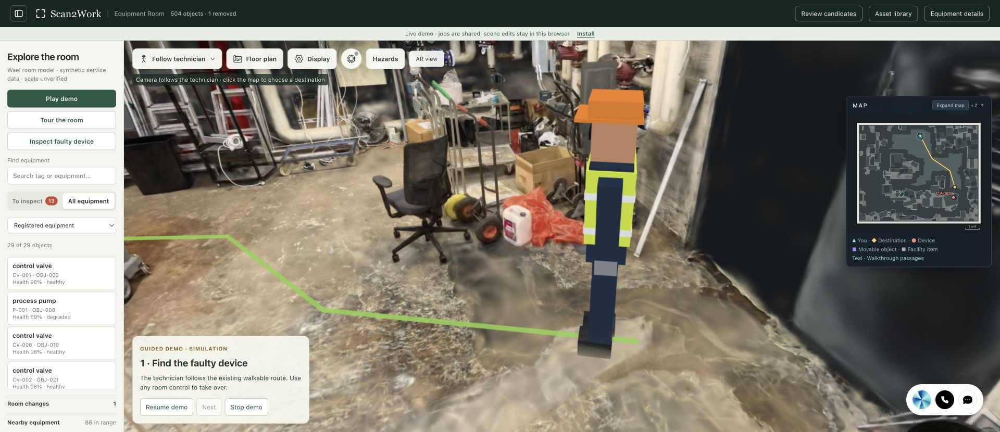
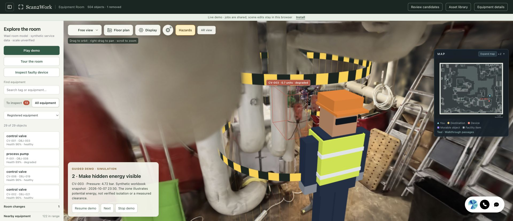

# Rasmus integration: hazards, technician and demo

Reviewed source: [SinceAI-2026/rasse at 5a3ca02](https://github.com/SinceAI-2026/rasse/tree/5a3ca0241255c7a22bafede9c251ba2ab058e849).
The integration keeps Scan2Work's existing room, navigation, equipment bindings,
Ilkka, shared inspection jobs and Arduino panel.

## What to reuse

| Feature | Source | Scan2Work adaptation |
| --- | --- | --- |
| Walking service technician | `demo/web/src/meshes.ts`, `makeTechnician` | The same procedural hard hat, high-visibility vest, coveralls and walking limbs, adapted to our up/forward axes. A wider runtime navigation profile accommodates the uniformly scaled model. No external character asset is required. |
| Hazard views | `hazards/rules.json`, `demo/web/src/hazardFx.ts` | Focused energy annotations, amber rings and a selected illustrative danger boundary at our equipment positions. Optional while browsing. |
| Guided demo | `maintenance/web/demo.ts`, `demo/web/src/stage.ts`, `camera.ts` | One interruptible walkthrough with a short explanation at each stage. Demonstration state stays separate from shared jobs and Arduino. |
| Device summary | `backend/status.py`, `demo/web/src/devices.ts`, `xr/hub.ts` | One canonical status, the reason, one relevant reading, its recorded source/time and the next check. Existing detailed evidence remains available. |

These are adaptations of Rasmus Mäkinen's implementation and presentation
patterns. The entire second viewer and its generated asset catalog are not
dependencies of the main app.

## What belongs in the default device view

| Information | Display decision | Reason |
| --- | --- | --- |
| Equipment tag and name | Always | Establish which device is selected. |
| Workbook condition and issue | Always for mapped equipment | Keep the room, inspection queue and assistant consistent. |
| Most relevant reading | One value and one comparison | Explain the issue using the device's own recorded setpoint or baseline. |
| Source and snapshot time | Compact line beside the reading | Recorded synthetic telemetry must not look like a live plant feed. |
| Next inspection check | One clear action | Give the user a useful next step. |
| Full trends, alarms and service history | Expandable evidence | Available without crowding the first view. |
| Model confidence | Preserve upstream specifications, labeled condition-model confidence and only for mapped equipment | This is not measured object-recognition accuracy. |
| Raw geometry and classification details | Secondary scan details | Keep extraction internals out of the main service summary. |
| Device readings for unmapped objects | Show no linked workbook status | Avoid inventing equipment records for scene objects. |

The first integration uses the active Scan2Work twin's own telemetry. Peer
comparisons require compatible units, time windows and a defined peer group;
Rasse's precomputed ratios are not transplanted into a different scene.

## Data and geometry decisions

Rasse's reviewed scene contains 253 objects: 30 workbook-backed records,
73 procedurally generated device records and 150 object-only entries. The
Scan2Work baseline contains 504 objects, with 30 mapped workbook records. All
30 workbook tags overlap, but their scene bindings and coordinates differ.
For example, P-001 is Rasse's `BOX-0157` and Scan2Work's `OBJ-008`.

Use existing Scan2Work object IDs, centers, bounds and workbook IDs. Generated
service dates, copied peer readings, a second canonical condition and Rasse's
estimated `mpu=1.082` are not imported. Scan2Work's physical scale remains
unverified. Character dimensions and hazard boundaries are visual geometry in
the current scene frame, not a new physical survey or certified clearance.

The original narrow robot route does not accommodate a proportionally scaled
technician. A runtime copy of the walkable grid is restricted using the source
clearance field and the animated avatar's footprint. The existing planner then
finds a new service stopping position. The original scan, floor geometry and
dataset remain unchanged. Manual walking and later route planning use the same
profile, so the guided demo does not get a special collision exemption.

## Hazard interpretation

The class-to-energy rules and thresholds are generic demonstration assumptions.
They describe potential energy and recorded synthetic signals, not hazards
detected from the scan or a live isolation check. Missing or non-finite readings
stay unknown. Zero motor current does not establish electrical isolation, and
heat cannot disappear because another source reaches zero. There is no automatic
“safe to work” decision or inferred nearest isolation valve/cabinet.

The first hazard layer is a visual annotation. Obstacle-aware room navigation
uses the technician profile; a drawn hazard boundary does not certify a new
safe route or change the routing mask. The demo does not inherit the source viewer's exception that lets
routes enter their target's danger zone. It does not complete safety checks,
save maintenance notes, close jobs or create Arduino heartbeats automatically.
Those existing workflows remain available for deliberate user interaction.

## Reusable interfaces

- `pipeline.scene_context.build_scene_context(twin)` returns JSON-ready context without side effects. The server exposes it at `GET /api/scene-context`.
- `makeTechnician(THREE, {height})` returns the avatar root, footprint and displacement-driven animation; `withTechnicianClearance(navigation, {height, assets})` copies/restricts the runtime grid to match it.
- `summaryFor(asset, context)` produces the compact device view; `renderDeviceSummary(...)` renders it. `createContextRefresh(...)` follows existing fault-panel notifications, drops stale responses and clears unavailable readings without adding a polling loop.
- `createHazardLayer(THREE, host)` uses callbacks for the current objects, selection and position. Moving/removing an object updates its annotation.
- `createSafetyStory(host)` needs only navigation and presentation callbacks. `mountSafetyDemo(...)` adds the interruptible controls and captions. Neither receives a job, sensor or persistence API.

The backend uses the Python standard library; the viewer uses bundled Three.js and browser APIs. No new model,
service credential or character download is required. See [the dependency map](dependencies.md).

## Verification

The local baseline demo reached CV-003 and completed all three stages without creating a job or changing sensor
state. Pause/resume, manual takeover, free-view browsing, hazard toggle and the compact evidence card were checked
at desktop and narrow widths. Upstream's latest Take apart/specifications/photo-before-checklist layout is retained.

The animated footprint is 0.301 scene units. Independent dense sampling of the newly planned target routes found:

| Dataset | Route length (scene units) | Minimum obstacle clearance | Dense samples |
| --- | --- | --- | --- |
| Baseline, 504 objects | 4.682 | 0.414 | 4,684 |
| Extraction review, 1,933 regions | 4.163 | 0.364 | 4,165 |

All 470 manual movement samples on the baseline route passed. The runtime profile only restricts walkable cells;
it does not open source obstacles or replace original floor evidence. These are checks of the target routes,
not proof of reachability for every device or measured real-world human clearance.

Automated checks cover gait/footprint, route restrictions and edits, moved/removed hazard anchors, demo interruption,
canonical status, missing/non-finite readings, hot bearings, zero-current interpretation and scripted fault provenance.
No paid pipeline rebuild was run. Deployment and final regression counts are recorded below.

Backend regression: 74 focused tests passed across scene context, public access, MCP, Arduino, media ranges, runtime compatibility and shared inspection jobs.

Frontend regression: 54 focused tests passed; both idempotent viewer patch scripts reported 0 edits. Browser Tour the room produced a 14.2-unit route with working Pause/Continue on the technician profile. Runtime context refresh was checked for out-of-order responses and unavailable readings.

## Hosted deployment

The main room and extraction review run source `458d749056fc1b70d0c370badc90f5f17f50ed18` from an isolated code
snapshot. The original 0.1.1 release archives and generated scene data were not rebuilt.

| Public site | Scene objects/regions | Mapped summaries | Potential-energy annotations | Hosted integrations |
| --- | --- | --- | --- | --- |
| [Main room](https://scan2work.app/) | 504 | 30 | 27 | Ilkka, shared jobs and Arduino enabled |
| [Extraction review](https://review.scan2work.app/) | 1,933 | 30 | 27 | Voice, jobs and Arduino disabled |

Both public endpoints serve the new modules and scene context successfully; served module hashes match the code
snapshot. The shared job log and assistant configuration were unchanged. Both datasets’ source PLY, membership archive and rendered point buffer match their installed 0.1.1 inventory hashes. Existing MCP, board tunnel, proxy and host
management processes were not restarted. The Arduino board remains offline with no heartbeat, as it is not connected.
Browser-local scene edits remain separate from the canonical dataset counts above.

The deploy backup is `deploy/rollback-web-458d749` on the host. Rolling back only the two web service code paths does
not require changing data or restarting MCP/tunnels. The deployment archive SHA-256 is
`e3fe1d82bedf19723704b6f77edcbb766723d57ce48c8b092417a108ca52448d` (15,050,811 bytes).

Live browser verification completed all three guided stages, manual takeover and hazard toggling. The source photo,
compact status and job panel retained their order. Ilkka was visible; Arduino correctly showed offline/no heartbeat.
The extraction review loaded 1,933 regions and an unmapped Bucket showed no assigned device readings. No browser
errors were observed. The existing single browser-local removal was preserved; no job or board actions were performed.

