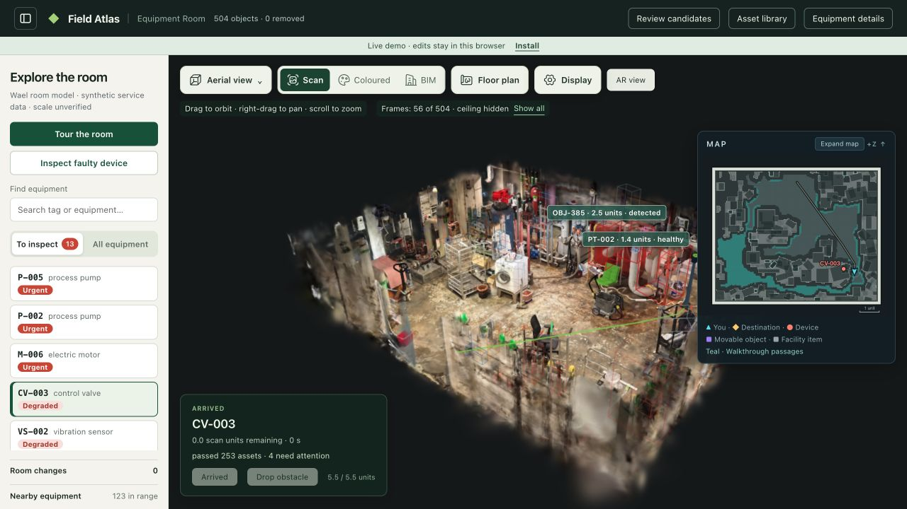

# Scan2Work 0.1.0: published release verification

Verified 7 November 2026. This is the first public release; the earlier
`2026.11.07-preview.1` note records the local packaging pilot.

## Public endpoints

- [Room demo](https://scan2work.app/) — original 504-object room.
- [Extraction review](https://review.scan2work.app/) — separate 1,933-region dataset.
- [Installer and downloads](https://assets.scan2work.app/releases/0.1.0/index.html).
- [Release manifest](https://assets.scan2work.app/releases/0.1.0/manifest.json).
- [Checksums](https://assets.scan2work.app/releases/0.1.0/SHA256SUMS).

The release was built from clean commit
`5b23655e528c82d5bc76a94936d90bcc46b4a639`. Subsequent verification/documentation
commits do not change these immutable archives.

| Archive | Bytes | SHA-256 |
| --- | ---: | --- |
| Code | 5,340,277 | `57f693fbc2643a24f69340b4b8e4cbabe4d6ca33ddada3efcafc591109685cdd` |
| Original room | 771,097,944 | `baabc8fd46a2874949958332674c66460a13a55c564a5b6bbd0e3ddb78a48c4e` |
| Extraction review | 655,527,366 | `6243fcee53db7ba1973ee0968969df21f97caa770b56f600fb4ad3fc71e6b87e` |

Both data archives are byte-identical to the locally verified preview archives.
The native source scan checksum is
`83d8c7d99316c08c9719cfc2c5a6b9d1903b89847780e2458adc662c79f32955`.
No extraction, relabelling or source-data rebuild was performed for publication.

## Installation and delivery checks

All 12 published files were downloaded over public HTTPS and checked against
full SHA-256 digests. The manifest was published last. The temporary,
authenticated multipart upload Worker and its short-lived local/remote secrets
were removed after verification; the R2 release remains available independently
of the app host. Future uploads can use the documented bucket-scoped S3 publisher.

A fresh Linux x86-64 installation used the actual public `install.sh` and
`manifest.json`, downloaded both datasets, installed the 13 pinned binary-wheel
dependencies under Python 3.12.3, passed `pip check`, checked archive/file
inventories, and passed the launcher's HTTP startup doctor for both views.
The installed runtime needs no model key or GPU. The earlier local pilot also
validated a clean macOS Apple Silicon installation; see the historical note.

Focused validation covers 44 Python tests across installer (13), runtime/media
compatibility (27), and release packaging (4), plus 18 JavaScript tests covering
hosted controls, local edits, optional review links, AR discovery and edge proxy
boundaries. Both required viewer patch scripts reported zero edits.

## Live browser and API checks

- The main viewer loaded 504 objects and the explicit hosted-mode banner.
- Inspect faulty device traversed the 5.5-scan-unit route and arrived at CV-003,
  opening its source photograph, workbook guidance and telemetry.
- The floor plan displayed all 504 objects and all 87 fitted cylinders when both
  visibility filters were enabled. Walkthrough-derived passages remain present.
- AR video played at 1280×720 with its clock advancing; ranged HTTP requests
  returned 206. The separate extraction dataset has no AR video of its own.
- Candidate review loaded 1,933 proposals without appending them to the original
  504-object catalog. The full review also rendered at its separate HTTPS origin.
- The public edge passed offline diagnosis and stateless work-order drafts, and
  rejected shared library writes. Draft responses explicitly returned
  `persisted=false` and `DEMO_DRAFT`.
- Existing object downloads, browser-local remove/reload/restore and installed
  saving behavior passed isolated browser/regression checks before deployment.
- Both live viewers had no browser console errors in the exercised flows.

## Operational limits

The browser demo uses separate supervised, offline, read-only Python processes
on the team's existing instance, behind Cloudflare Workers. Room edits are local
to the visitor's browser; install locally to save jobs or create new native
object exports. Diagnostics use the prepared synthetic records and local
retrieval; external voice/model services are not enabled in this release.

The current instance must stay running. Its filesystem does not survive instance
recycle/destroy; R2 downloads do. Reinstall on a persistent CPU host and update
the edge origins before retiring it. The public HTTP origins contain only demo
content, not management services. An operational service needs an encrypted
private origin and authenticated users.

Physical scale is unverified. Object counts are not detection accuracy, and IFC
export remains approximate scan geometry rather than surveyed BIM. The main
room's existing evidence and the new review proposals retain distinct provenance.

Cloudflare's domain/certificate and public DNS checks passed. The live pages
opened in the in-app browser and the public installer worked from Linux. The
Mac's system resolver still retained earlier negative DNS results during some
shell checks; DNS propagation/cache refresh can temporarily affect command-line
access even while the browser and other networks work.
