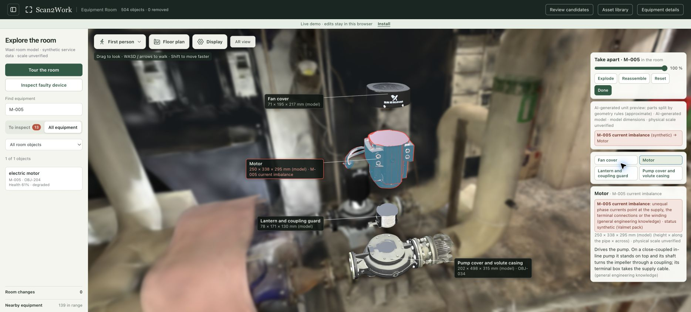

# Scan2Work 0.1.1 verification

Built 7 November 2026 from clean commit `365384ca5503c39937579d4d80ab14002c7c9ee7`.
This release merges upstream through `2fc5873`, including PR #3 (in-room
Take apart and AI-generated GLBs), PR #9 (optional Arduino panel), and Scan2Work
branding. Verification documentation added later does not change these archives.

## Published downloads

- [Installer and downloads](https://assets.scan2work.app/releases/0.1.1/index.html)
- [Manifest](https://assets.scan2work.app/releases/0.1.1/manifest.json)
- [Checksums](https://assets.scan2work.app/releases/0.1.1/SHA256SUMS)

All 12 release files were downloaded over public HTTPS and verified with full
SHA-256 digests. The manifest was published last. The original 0.1.0 downloads
remain unchanged. The temporary upload Worker and its local/remote upload
credentials were removed after verification.

The [room](https://scan2work.app/) and [separate review](https://review.scan2work.app/)
now serve 0.1.1; both advertise its download URL. Public checks confirm the
504/1,933 catalogs, GLBs and navigation, baseline video range responses, and
hardware/shared-write denial. Only the two app processes were restarted; the
proxy and management services were unchanged. The 0.1.0 installation and launch
wrapper remain available for rollback.

## Data preservation

Both data archive inventories were compared with 0.1.0: **zero existing files
changed or removed**. Each dataset adds only `take_apart/index.json` and 23 GLBs
(five split assemblies and 18 room-model files). The original 504-object room,
floor/navigation, AR video, photos, workbook bindings and exact source membership
remain byte-identical. The separate review still contains 1,933 regions.

| Archive | Bytes | SHA-256 |
| --- | ---: | --- |
| baseline | 801,335,826 | `da7f7777bb363a2fd51f475b939e7792fe0e003558f41a189196bddd85af3941` |
| extraction | 685,768,716 | `b4a6d88c269d93df69f53f887920cd279c511e6f7f1a024adae98eebe33d51ed` |
| code | 5,528,477 | `dc31a60a5c407e98ebb25c7afd8dcdc03ddb892fdf2860aadf8e6e8e529b4982` |

## Integration checks

- 48 backend/installer tests, five release-packaging tests, 39 frontend tests,
  and two HTTPS proxy tests passed. Both required viewer patch scripts reported
  zero edits.
- A fresh Linux Python 3.12 installation installed all 13 pinned dependencies,
  passed `pip check`, full file inventories, native-source alignment and both
  startup doctors. Optional model references and GLB headers are validated.
- Isolated browser checks: selecting M-005 walks to its pump, opens four
  selectable parts, highlights the synthetic current imbalance on the motor,
  reassembles and returns to the room without console errors.
- Moving or removing an assembly owner falls back to exact scan rendering;
  reset/restore brings the illustrative assembly back. No source object is
  deleted or hidden by a stale generated model.
- The 1,933-region review retains search, 16-frame source evidence for the
  tested region, and its exact 306-Gaussian isolation.
- Temporary public-runtime checks passed for both installed datasets, all 23
  GLB files, the native PLY, navigation and grounded offline copilot. Baseline
  video range requests returned 206. Hardware GETs and shared writes returned
  403 before any live store import; browser QA made no hardware API requests.

## Live browser proof

The public main site was exercised after activation: Scan2Work branding,
504 objects, the 0.1.1 Install link, M-005 navigation (2.8 scan units), four-part
Take apart, Reassemble at 0%, and Done returning to the normal inspector all
passed. The public review site retained its 1,933 regions and the tested
16-frame evidence / 306-Gaussian isolation. Both browsers had no warnings or
errors in these flows. The public release manifest also loaded from macOS after
its earlier DNS cache issue cleared.

## Interpretation and operation

Model attachment uses fitted positions and bounding boxes, not verified object
identity. Generated meshes and their split parts are illustrative; dimensions
and physical scale remain unverified. They do not establish better detection or
measured reconstruction accuracy. Synthetic faults appear only on objects with
current workbook bindings; unmatched regions do not borrow fault records.

The public demo keeps edits in each browser and disables shared writes and the
Arduino panel. Local installation retains saving/export and optional hardware
integration. The app still depends on the current supervised instance staying
running; R2 downloads are independent of it. Release 0.1.0 is retained unchanged
for rollback. See [the original deployment verification](release-0.1.0.md) for
host boundaries and [installation](installation.md) for immutable updates.
