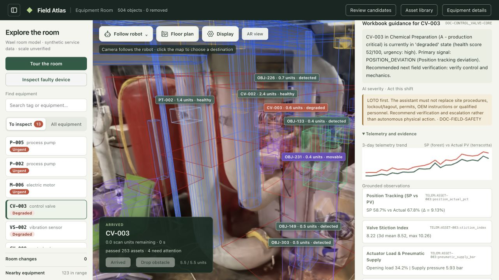

# Scan2Work release verification

Release: `2026.11.07-preview.1`. Prepared for `assets.scan2work.app`; **not uploaded or published** by this task.

## Verified before package assembly

- Fresh Python 3.12 environment on macOS Apple Silicon: all 13 exact runtime dependencies installed from binary wheels, `pip check` passed.
- Linux x86_64 Python 3.12 binary wheels: all locked packages resolved and downloaded. This is dependency availability verification, not Linux execution or browser testing.
- Archive-builder tests: mutable state/credentials excluded, source JSON unchanged, unsafe symlinks rejected, archive inventories match file hashes, deterministic archive bytes, publisher detects tampering.
- Viewer portability: optional full-view URL follows configuration; offline voice creates no CDN widget. Full dependency notices included.

## Complete installation checks

- Installed the real code, baseline and extraction archives into a new directory, with a newly created virtual environment. Archive checks, dependency installation, `pip check`, both dataset preflights and both ephemeral HTTP startups passed.
- Independently exercised `install.sh` through a local HTTP download mirror, with an explicit `--allow-http` test flag, into another new directory. The baseline-only installation and doctor passed. Production downloads require HTTPS.
- Started the full installed package on custom ports 8896/8898. The served candidate link correctly used 8898 rather than the developer's default 8768.
- Confirmed 504 original room objects, 1,933 optional extraction regions and five shipped library entries.
- In the browser, completed the 5.5-scan-unit route to CV-003/OBJ-206; arrival opened the workbook guidance and real source photo. Candidate evidence loaded, and the full-inspection link used the configured port.
- AR video decoded at 1280×720, readyState 4, with no video error. HTTP byte range returned 206 and the correct two bytes from the 64,819,691-byte packaged file.
- Saved OBJ-004 into the installed library: native PLY contains 977 original Gaussian rows, with GSPL, source-row IDs and thumbnail. No PyTorch or API model was used.
- Floor plan retained 504 objects, 87 fitted object cylinders and four wall guides. Downloaded a 720,437-byte IFC4 file with a valid STEP header/end marker. This check verifies download/format markers, not a new IFC schema or geometric accuracy assessment.
- No browser console errors were observed in the checked workflow.



## Regression checks

31 focused Python tests passed, covering the builder, installer, launcher, server configuration, active-dataset media ranges and existing runtime policies. Eight focused JavaScript tests passed for candidate URL portability, independent inventories and offline voice bootstrap. The viewer agent also ran the broader 25-test portability/compatibility set; both required patch scripts reported 0 edits.

```sh
VALMET_OFFLINE=1 python3.12 -m unittest \
  tests.test_distribution_installer tests.test_installed_server \
  tests.test_media_ranges tests.test_runtime_compatibility distribution.test_release
node --test web/proposal-review.test.mjs web/offline-voice.test.mjs
```

The R2 publisher's checksum validation and dry-run command generation passed. No R2 API credential was needed or used for those checks; the dry run performs no network mutation.

## Distribution size and remaining limits

Asset download sizes: approximately 771.1 MB baseline + 655.5 MB optional extraction. Code/documentation adds about 5.4 MB. Both datasets unpack to approximately 1.69 GB before the Python environment. Exact bytes and SHA-256 values are in the release manifest and `SHA256SUMS`.

Validated on macOS 26.6.2 Apple Silicon with Python 3.12.13. Linux wheels were resolved, but no Linux runtime/GPU/browser test was performed. Windows native installation is unsupported. Initial dependency installation needs package-index access; this is not an air-gapped wheel bundle.

The six historical detection-canvas JPG references missing from the original archive remain unavailable; active source-photo/evidence paths are complete. Full training, voice setup and scale calibration are outside this prepared-data installation. No paid inference, scene rebuild or source dataset modification was performed. Public R2/domain verification remains a deployment step after upload.
