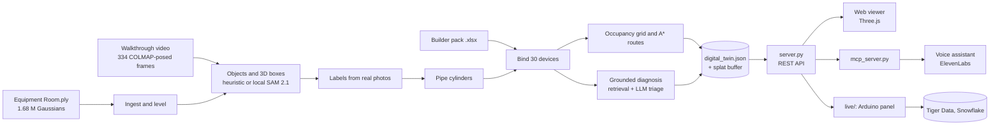

# Scan2Work: technical note

Valmet × Since AI 2026, Industrial Metaverse challenge. This note covers the models, libraries and software
components behind the four parts of the brief: 3D semantic extraction, obstacle-free pathfinding, Excel
metadata mapping and the AI approach. Detail and measurements are in [technical notes](technical-notes.md); the
stages are summarised in [pipeline](pipeline.md).

## 1. Architecture

The pipeline (`python -m pipeline.run`) runs once, offline, and writes one twin file plus a binary splat buffer.
Everything after that only reads the twin, so the demo runs without any model or API.

## 2. 3D semantic extraction

| Step | Method | Components |
|---|---|---|
| Ingest | Decode position, scale, rotation, colour and opacity; drop corrupt rows; level the room to y-up with the floor at 0 | NumPy |
| Objects (default) | Colour and geometry rules, DBSCAN clustering, oriented boxes fitted in each object's own axes (3rd–97th percentile, so floaters do not inflate them) | NumPy, SciPy, scikit-learn |
| Objects (local option) | SAM 2.1 automatic masks on every posed video frame, stitched into 3D objects by view consensus (MaskClustering), then a box per object | PyTorch, Transformers, pycolmap |
| Labels | Each object's sharpest real video frame, with its box drawn in, is labelled into a fixed vocabulary; open-vocabulary detection on video keyframes, lifted to 3D, adds objects clustering missed | Gemini; locally SigLIP 2, DINOv2, OWLv2 and a linear probe |
| Pipes | Surface-normal voting for pipe axes and radii | NumPy, SciPy |

Result: 504 framed objects in 24 classes in the release room; label accuracy 85 % on 39 hand-labelled objects (colour
rules alone: 13 %). Pipeline approaches that were tried and dropped are in [pipeline](pipeline.md#how-we-got-here).

## 3. Obstacle-free pathfinding

- **Walkable floor and obstacles.** Splats between 0.16 m and 1.62 m above the floor (below the overhead pipe rack)
  mark 5 cm grid cells as solid; equipment boxes are added as solid footprints.
- **Clearance.** A distance transform gives every cell its clearance; cells closer than the robot radius (0.15 m)
  plus a safety margin are blocked.
- **Route.** 8-connected, distance-minimising A* on the free cells; straight segments are kept only where every
  sample stays walkable, and corners are rounded for a smooth walk.
- **Goal.** A clear stand-off cell 0.35–1.45 m from the target's box, so the robot stops facing the device.
- **Proximity.** A k-d tree lists every asset within 2.5 m of each waypoint; the viewer frames and labels them as
  the robot passes.
- **Checks.** 0 path samples off the walkable floor, minimum clearance 0.234 m, no equipment box crossed; the
  obstacle map agrees with the path a person walked in the video (under 5 % of camera poses on solid cells).

Components: `pipeline/navigation.py` (NumPy, SciPy `cKDTree`), `web/navigation*.mjs` for live re-planning in the
browser.

## 4. Excel metadata mapping

- **Procedural binding.** Each of the 30 builder-pack devices is bound to a distinct object of a matching class,
  scored by class fit and position; CV-003 (degraded, position deviation) is the pre-determined faulty target, placed
  on the motorised control valve verified in the real video.
- **Only Excel values.** Status, telemetry, alarms, maintenance history and service documents are read from the
  workbook; objects without a record show their scene label and no borrowed telemetry. The scorecard checks that
  every mapped telemetry value exists in the workbook (0 mismatches).

Components: `pipeline/knowledge.py` (pandas, openpyxl), `pipeline/asset_records.py`.

## 5. AI approach

- **Retrieval.** Workbook documents, historical cases and asset cards are indexed (EmbeddingGemma, or TF-IDF when it
  is not installed); the target's own case comes back first.
- **Diagnosis.** An LLM gets the device's telemetry trends, alarms and retrieved evidence and returns typed output:
  observations, ranked root-cause hypotheses, severity, data trust and LOTO-first verification steps. Every claim
  cites a workbook ID, and the scorecard checks that each cited ID exists. A deterministic rule-based diagnosis is
  the fallback.
- **Evaluated blind.** With the answer hidden and telemetry only, the diagnosis finds the right root cause for 9 of
  13 faulty devices (top-3: 11/13), against 2/13 for the most common issue per class.
- **Technician workflow.** The checklist is the device's verification procedure; the safety step must be confirmed
  first, and a job closes as fixed only when every step is done. A voice assistant works the same job over MCP.
- **Caching.** Model answers are cached (`web/data/decisions_cache.json`), so a rebuild is reproducible without keys.

## 6. Models

| Model | Used for | Runs | Needed? |
|---|---|---|---|
| Gemini 3.8 Flash | Object labels from video photos; 2D detection lifted to 3D | Hosted (Google) | No: cached answers ship with the repo |
| OpenAI Decisions API (`gpt-6-luna`) | Diagnosis triage; label fallback | Hosted (OpenAI) | No: cached, with a rule-based fallback |
| EmbeddingGemma 300M | Semantic retrieval | Local | No: TF-IDF fallback |
| SAM 2.1 (hiera-large) | Class-agnostic masks per frame (local segmenter) | Local, Apache 2.0 | Only for `VALMET_SEGMENTER=local` |
| SigLIP 2, DINOv2, OWLv2 | Naming, look-alike types, detector second opinion (local segmenter) | Local, Apache 2.0 | Only for the local segmenter |
| Gemini 3.5 Flash via ElevenLabs | Voice assistant Ilkka | Hosted | Optional, off by default |
| Higgsfield | AI-generated 3D models of five pump units (illustrative, unverified dimensions) | Generated once, shipped as GLB | No |

Excluded on purpose: SAM 3 (its licence excludes nuclear use; Valmet supplies nuclear plants) and YOLO (AGPL).

## 7. Libraries and software components

| Layer | Components |
|---|---|
| Pipeline | Python 3.12; NumPy, SciPy, scikit-learn, pandas, openpyxl, Pillow, Matplotlib; PyTorch for object refinement |
| Camera alignment | COLMAP / pycolmap: the 334 video frames posed and aligned to the splat |
| Local segmenter | PyTorch, torchvision, Hugging Face Transformers, Accelerate |
| Server | `server.py` on the Python standard library (`http.server`): REST API, media ranges, job log |
| Viewer | Three.js r170 (bundled) with a custom EWA Gaussian-splat shader and a Web Worker depth sort; Hugeicons; no build step |
| Voice | `mcp_server.py` (MCP tools over the job log), ElevenLabs agent and widget |
| Hardware | Arduino UNO Q app (`arduino/`); `live/` writes board heartbeats to Tiger Data (TimescaleDB) and its event log to Snowflake, both optional |
| Exports | Semantic floor plan (SVG/PDF/PNG), IFC4 and GLB from the browser, `.ply`/3DGS object library |
| Packaging | `distribution/` installer with pinned wheels and SHA-256 manifest; hosted at scan2work.app |

## 8. Running and reproducing

- **Prepared demo:** the installer, or `python server.py 8765` with the generated data. No GPU, key or model download.
- **Rebuild:** `bash scripts/check.sh` rebuilds the twin from the challenge files and runs the scorecard against the
  brief. Keys (`GEMINI_API_KEY`, `OPENAI_API_KEY`, `HF_TOKEN`) are optional while the cache covers the answers.

## 9. Limits

- Object recognition is measured on a 39-object hand-labelled sample, not on the whole room.
- Navigation is kinematic and grid-based: no robot dynamics or moving obstacles.
- The workbook is synthetic and bound procedurally, as the brief allows; the filmed equipment is not known to be
  faulty. Physical scale and the AI-generated models' dimensions are unverified.
