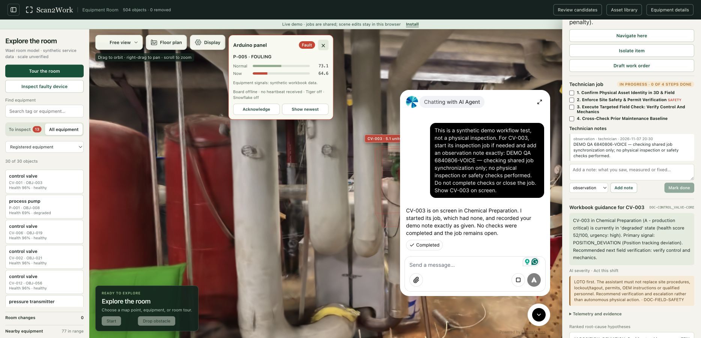

# Public MCP and ElevenLabs voice

The source includes two independent integrations: the MCP equipment-data server
and the browser ElevenLabs widget. Ilkka is managed in Wael's ElevenLabs workspace.
The original public demo disabled the widget together with offline model inference.
The main hosted app now enables Ilkka, all ten inspection tools and the Arduino
panel separately from backend model policy; the extraction review and immutable
0.1.1 downloads keep voice off. Shared inspection writes are enabled on the main
site. See the final deployment section for its current state.

## Connection for Wael

| Setting | Value |
| --- | --- |
| MCP URL | `https://scan2work.app/mcp` |
| Transport | Streamable HTTP (JSON responses; no SSE stream) |
| Authorization | `Authorization: Bearer <workspace secret>` |
| Existing agent | `agent_5501m6v02k69e2r8fwc0hznmfda5` (Ilkka) |
| Main widget hostname | `scan2work.app` |
| Optional review hostname | `review.scan2work.app` |
| Dynamic variable | `selected_equipment`, default `none` |

The MCP credential belongs only in the ElevenLabs workspace secret and the private
server configuration. Never put it in the widget, repository, a URL, screenshot
or public README. The deployed endpoint requires it even for loopback calls.

1. In the agent configuration used for the public site, replace the old tunnel
   MCP connection with this URL, HTTP transport and private bearer credential.
   Refresh its available tools. If the original Ilkka must retain local job-writing
   behavior, make a separate public agent configuration and supply its agent ID
   when enabling the widget.
2. In the default read-only mode, use the six read tools: `find_equipment`, `get_equipment_status`,
   `list_open_problems`, `get_procedure`, `search_service_knowledge`, `get_job`.
   It does not expose `start_job`, `complete_check`, `add_note` or `close_job`;
   attempts are rejected. If shared inspection jobs are explicitly enabled as
   described below, refresh the agent's tools to include those four writing
   tools too. Match its instructions to the chosen mode; read-only assistance
   must not claim to have recorded maintenance actions.
3. Keep the existing browser client tool `show_equipment`, and configure the
   `selected_equipment` variable. Its JSON parameter schema is:

   ```json
   {
     "type": "object",
     "properties": {
       "equipment": {"type": "string", "description": "Registered equipment tag, e.g. CV-003"}
     },
     "required": ["equipment"]
   }
   ```

   The client selects/focuses the equipment and returns a spoken result string.
   Unmapped scene objects pass `none` instead of borrowing a workbook tag.
4. Allow the intended hostname in the agent's widget configuration. Test a
   question about CV-003 and a request to show it. Verify actual MCP tool calls
   in the ElevenLabs conversation. Widget visibility alone does not verify the
   cloud agent's MCP connection.

[ElevenLabs MCP setup](https://elevenlabs.io/docs/eleven-agents/customization/tools/mcp)
and [widget configuration](https://elevenlabs.io/docs/eleven-agents/customization/widget)
describe their side of this connection. No ElevenLabs API key is sent to visitors.

## Run the service

Use the prepared baseline dataset and its installed Python environment, with
this branch's code. Set `FIELD_ATLAS_MCP_PUBLIC=1`, `VALMET_OFFLINE=1`,
`VALMET_DATA_DIR=/absolute/path/to/data/baseline`, and a private
`FIELD_ATLAS_MCP_TOKEN` of at least 32 characters. Run `python mcp_server.py 9090`.
It binds loopback; put the dedicated encrypted transport in front of it.

Public startup selects offline policy before configuration or retrieval imports.
By default it ignores operator job history and cannot persist jobs. To preserve
Wael's hosted assistant workflow, set `VALMET_PUBLIC_ASSISTANT=1` on the MCP
process and start the viewer with `--assistant`, using the same baseline data.
That explicit mode exposes all ten tools and shares the inspection job log;
write fields are limited to 1,000 characters. Enable Worker `ASSISTANT="1"` for
browser job POSTs. Scene/library/hardware writes remain blocked. The supplied
host wrappers read the same flag from `deploy/assistant.env` so both processes
agree. Normal installed MCP retains its existing ten-tool behavior. HTTP requests are bounded to 16 KiB,
eight batch entries and four concurrent batches in public mode.

The public site's Cloudflare Worker forwards `/mcp` only to `MCP_ORIGIN`, which
must use HTTPS. The demo uses a separate supervised quick tunnel. Its hostname
can change on restart, requiring a Worker configuration update; the public URL
remains `https://scan2work.app/mcp`. Management services are separate.

## Enable the widget

With this branch deployed, configure `VALMET_VOICE_AGENT_ID` and optionally
`VALMET_VOICE_AGENT_NAME=Ilkka` / `VALMET_VOICE_MCP_URL=https://scan2work.app/mcp`.
The server projects a validated `runtime.voice` object with `service_mode=read_only`
or `shared_jobs`, matching the configured assistant mode. It does not enable
backend model calls or scene/library/hardware writes. Wael's `--assistant`
without an explicit agent ID also retains the original Ilkka widget through
`runtime.voice_assistant`; no disabled override masks that opt-in. Loading the
widget does not start a conversation or request microphone access.

Malformed explicit configuration disables the widget. Without either explicit
voice configuration or `--assistant`, public/offline voice stays disabled. CDN
loading failure displays a short fallback to workbook guidance. Unmarked legacy
online scenes retain their original widget behavior.

The 0.1.1 downloadable archives remain immutable. This integration is a later
source change; its cloud agent binding and widget activation are not included
in the offline 0.1.1 installer.

## Initial read-only deployment — 7 November 2026

The public endpoint is deployed and tested through `https://scan2work.app/mcp`.
Unauthenticated requests return 401. Authenticated initialization and all six
read tools passed against the 504-object baseline; all four job-writing tools
were denied. The main room and separate 1,933-region review remain unchanged.
No operator history or lock file was created.

The initial service ran from immutable source snapshot `c37efcc` in its own supervised
process and encrypted tunnel, using the existing 0.1.1 environment/data. The
quick-tunnel origin is recorded as `MCP_ORIGIN` in the edge configuration; the private bearer
credential is stored separately and is not part of this repository.

Validation: 41 focused backend tests, 42 frontend tests and four edge proxy tests
passed. Both viewer patch scripts reported zero edits. Local browser QA showed
the explicitly enabled widget and verified selected-tag changes without
starting a call. These checks preceded the hosted widget activation below.

## Compatibility follow-up after PR #8

PR #8 was squash-merged before the MCP follow-up commits. PR #11 reconciled them
with upstream `49ae804`, preserving its navigation, fault-panel, optional
voice and shared inspection jobs. It does not reintroduce the installer changes
already merged in PR #8. At that stage the live endpoint still ran the
read-only `c37efcc` snapshot. The web compatibility fix merged as `243cbe2` and
is included in the hosted activation below.

Validation of the reconciled source: 46 focused backend tests, 17 frontend tests
and six edge tests passed. Temporary fixtures verified shared browser/MCP job
writes, the 1,000-character limit and other mutation denials. The default six-tool
MCP mode and upstream ten-tool shared mode are both covered. No production data,
services or agent settings were changed while preparing that fix PR.

## Hosted widget activation — 7 November 2026

The first widget activation used immutable source snapshot `e821396`,
which includes merged PR #11. `SCAN2WORK_CODE_DIR` selects that code while both
servers retain the existing 0.1.1 environment and datasets. No published release
archive or installed release code was overwritten.

The main server explicitly configures Ilkka's public agent ID, display name and
`https://scan2work.app/mcp` metadata. Its HTTPS manifest reports
`runtime.voice.enabled=true` and `service_mode=read_only`. The separate review
explicitly disables voice. Both retain `field_jobs_enabled=false` and
`shared_writes_enabled=false`; their catalogs remain 504 and 1,933 entries.
Only the two web services restarted. MCP, its encrypted tunnel, proxy and host
management services remained running; release manifests were unchanged.

Live browser QA confirmed the bottom-right Support/Message widget. Sending
“Show me CV-003 and explain its current condition” selected and focused CV-003,
opened its inspector, and returned a position-deviation explanation: actual
68% versus 59% setpoint, matching the prepared 67.792% / 58.66% readings. The
test used text only and performed no maintenance writes. No application or
ElevenLabs errors appeared. This verifies the hosted widget, a conversation
and the browser client tool; it does not establish which MCP endpoint the
cloud agent used internally.

Post-deployment checks also passed for all 23 GLBs on both servers, retained
routes (228 baseline / 187 review waypoints), AR video byte ranges, write
denials and the original installation's full integrity/dependency check.

See the [host deployment guide](../distribution/host/README.md#update-hosted-code-without-replacing-release-data)
for activation and rollback. The public agent ID is safe to expose; the MCP
bearer credential remains private. The cloud agent's connection is controlled
in Wael's ElevenLabs workspace and must be verified independently of the widget.

## Full hosted inspection and Arduino activation — 7 November 2026

At the user's request, the main web and MCP services now run source snapshot
`6840806` with `VALMET_PUBLIC_ASSISTANT=1`. The main web process also enables
`VALMET_PUBLIC_ARDUINO=1` and reads a distinct private device token file.
Cloudflare enables `ASSISTANT="1"`, `ARDUINO="1"` and the dedicated encrypted
board origin. The review remains read-only with voice and Arduino disabled.
The original MCP tunnel, scene proxy and host management services were retained.

The main widget reports `shared_jobs`; the MCP endpoint now lists all ten
tools. Live HTTPS verification started a clearly labelled CV-003 demo job from
the browser API, read it through MCP, added a note through MCP, observed that
note through the viewer API, recorded a simulated check and closed the test
job as not fixed. Its test entry was conditionally restored under the shared
log lock; other visitors' entries were preserved. Scene/library writes remained
blocked. This is a synthetic workflow test, not a physical inspection record.

Arduino state responds successfully using the board client's User-Agent.
Unauthenticated claim/heartbeat requests return 401. The board is not connected
yet, so state correctly reports offline, no heartbeat and no touch data.
Authenticated heartbeat, input validation and five-second expiry were tested
against isolated fixtures, without pretending a device was connected to the
live site. Tiger Data and Snowflake remain unconfigured. The updated board
client uses `Scan2WorkArduino/0.1` to avoid default-client blocking at the edge.

Validation: 58 focused backend tests, 48 frontend tests and nine edge tests
passed. Both viewer patch scripts reported zero edits. The
[Arduino setup guide](../arduino/README.md) explains the private board config;
the [host guide](../distribution/host/README.md#public-arduino-connection)
documents deployment flags, encrypted transport and rollback.

Live browser verification also passed: in a fresh text conversation, Ilkka
started CV-003's job and added the exact `DEMO QA 6840806-VOICE` observation
requested. It appeared in the actual shared Technician job card with 0/4 checks;
no physical inspection or safety check was claimed. The Arduino panel's
**Show newest** action selected P-005 and displayed its synthetic fouling signal
while still reporting **Board offline · no heartbeat received**. The test chat
was ended and the test-only job entry was conditionally restored under the
shared log lock without removing other visitors' records.
No application or ElevenLabs browser errors occurred.


